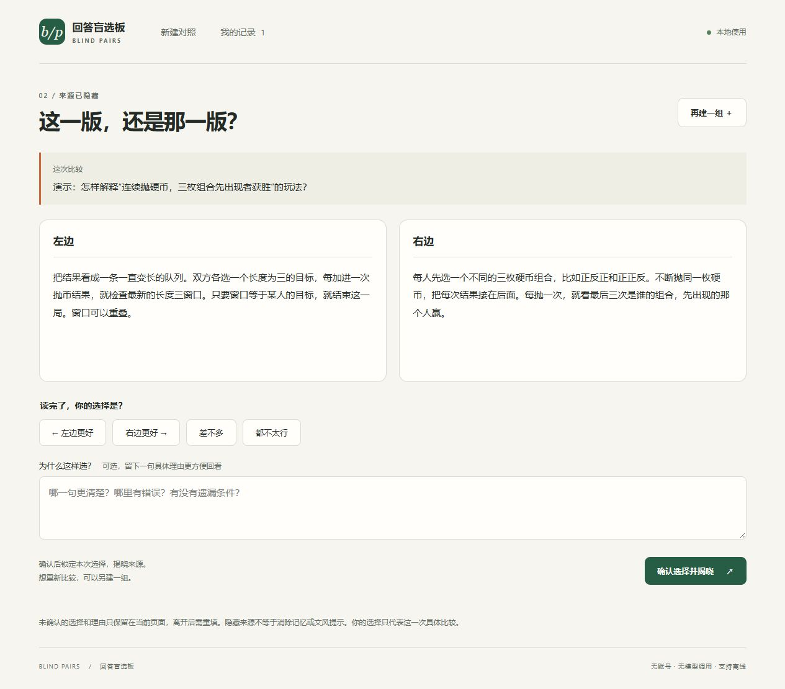

# 回答盲选板 · Blind Pairs

把两版回答、译文或说明放在一起，随机左右位置、隐藏来源，先选内容，再揭晓。

适合想比较两种解释、两次 AI 回答或自己的两个草稿时使用。它是一个本地小工具，不调用模型，也不需要账号。



## 打开就用

下载整个仓库并解压。**Windows 双击根目录的 `打开盲选板.cmd`**；其他系统用现代浏览器打开 `dist/index.html`。

不需要安装 Node、Python 或任何依赖。请保留整个 `dist` 文件夹，里面的样式和脚本需要一起使用。

1. 填问题或场景、两版内容和可选的来源标签。没有材料可先点“填入一组演示”。
2. 点“隐藏来源，开始比较”。左右顺序随机，进行中的对照也会保存。
3. 选择左边、右边、差不多或都不太行，可记一句理由；确认后揭晓来源并锁定选择。
4. 从“我的记录”回看，导出 JSON 备份，或导出 Markdown 阅读记录。

演示是两段自写的硬币游戏规则说明，没有预填的投票结果或模型成绩。

## 能做什么

- 保留原文，随机左右位置；比较界面在揭晓前不显示来源标签。
- 四种选择，记录理由，已完成的选择在界面中锁定；可以复制内容另开一组。
- 保存进行中和已完成的对照，刷新后从记录中继续。
- JSON 导入/导出，完整恢复原文、来源、左右顺序和选择；重复导入相同记录会跳过，有同编号冲突则整批拒绝。
- Markdown 阅读报告；尚未揭晓的记录在 Markdown 中不包含来源。
- 中文界面、窄屏布局、键盘操作，无外部字体、统计或网络请求。

## 保存与边界

内容保存在当前浏览器的本地存储中，不会上传。直接打开文件时，各浏览器的本地存储行为可能不同；移动文件、换浏览器、隐私模式或清理浏览数据后可能无法恢复。**重要记录请导出 JSON。**保存失败时会显示提示，当前页面可继续导出；未写入的内容在关闭后可能丢失。

最多保存 100 组。单题 6,000 字符、每段候选 30,000、来源 160、理由 4,000；备份有总量限制。导入前会验证版本、格式和记录一致性。无效备份不会覆盖现有记录。

隐藏来源只能减少显式提示：自己粘贴时可能已记得来源，文风也可能被认出。这不是科学双盲实验或模型能力排行榜。结果只代表记录者在具体题目上的选择。

完整 JSON 备份包含来源。隐藏和锁定都是本地界面行为，不是加密或防篡改；格式正确的手工修改不能被本工具辨认真伪。导出的 Markdown 或 JSON 都应先检查再分享。

## 开发与检查

运行不需要构建。开发检查使用 Node.js 22 或更新版本，无 npm 依赖：

```sh
npm test
```

核心在 `dist/core.js`：不可变记录、随机映射、来源隐藏、选择锁定、严格的备份校验。界面在 `dist/app.js`，用户文本只按纯文本显示。

如需通过本机 HTTP 打开（例如开发调试），在仓库目录运行：

```sh
python -m http.server 8080 --bind 127.0.0.1 --directory dist
```

然后访问 `http://127.0.0.1:8080/`。文件打开与不同网址之间不共享浏览器记录，可以通过 JSON 迁移。

## License

MIT
